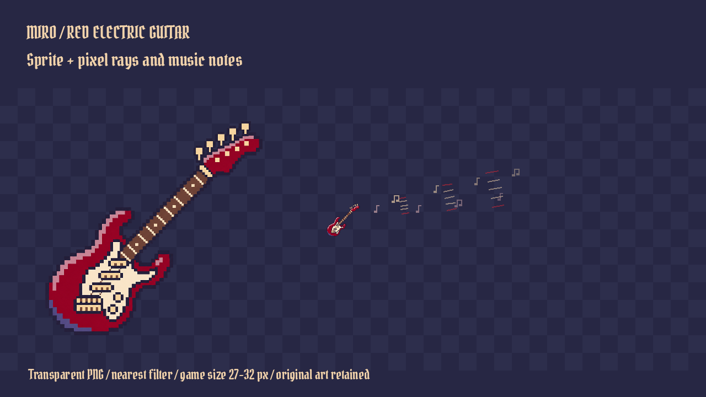

# Red guitar and music effects

The new guitar is `assets/weapons/guitar_red_v2.png`; the previous `guitar.png` is preserved. `scripts/weapon_art.gd` now selects the new variant. Julia's sprites were not edited. The generated source is 1254 square pixels with transparency; render at the existing 27px inventory size or 32px in-world with nearest filtering, rather than treating source resolution as world units.

Tiny notes are transparent 8x8 native SVG assets: `assets/weapons/music_note.svg` and `music_double_note.svg`. Their white pixels accept any CanvasItem tint; the effect uses cream and dusty rose. They are code-authored pixel masks, independent of fonts.

## Usage

`scripts/guitar_music_fx.gd` is a reusable Node2D. Add it beneath the guitar's sound origin, then call:

```gdscript
var fx = preload("res://scripts/guitar_music_fx.gd").new()
add_child(fx)
fx.strum(Vector2.RIGHT, 120.0)
```

It emits a bounded procedural burst (eight notes and fifteen ray segments), moving outward and fading for 0.35 seconds. Normal scene-tree pause freezes it. For an existing custom draw method, call `draw_burst(canvas, origin, aim, remaining_fraction, reach)` during `_draw`. IntroPlayer now does this using the existing strum timer, with the actual saved 120/170px off/on-beat radius. It does not change cooldown, damage, guard sleep, turret stun, sound or unlock conditions. The directional rays are cosmetic: existing gameplay targeting remains radial with sight checks.

Open `scenes/guitar_preview.tscn` for an animated preview. To capture it, run Godot with that scene and `-- --capture-guitar`. Output: `tmp/guitar/guitar-preview.png`. This is a rendered art preview, not a level screenshot. Existing Windows/Mac packages have not been rebuilt in this task.

Validation: Godot import and rendered preview completed without errors; easter-egg suite 22/22 and weapon inventory suite 9/9 passed.

## Generation provenance

The guitar was generated using the built-in image generation tool with transparent background enabled, then copied without altering the original PNG. The note icons and rays are repository-native code.

Final prompt:

> Generate one production-ready 2D pixel art red electric guitar sprite for the side-scrolling game Miro. Transparent background. Single isolated guitar only, no rays, music notes, text, logos or scenery. Match a 48x48 pixel sprite aesthetic with clearly stepped square pixel clusters, crisp hard edges, no antialiasing, no smooth shading, no 3D. Guitar body at lower left, neck pointing diagonally up-right at 45 degrees, full instrument fits square canvas with small transparent margin. Deep crimson red double-cutaway solid body, pale cream pickguard, dark aubergine outlines (#272744), muted violet shadows (#494d7e), dusty rose highlights (#c69fa5), warm ivory hardware (#f2d3ab), brown fretboard. Readable at 32x32 next to 32px tall characters in a dark pixel prison platformer. Flat side view, about 7 colors. Output exact 48x48 PNG if possible; otherwise maintain uniform large pixel blocks on a square image. Save generated image.


